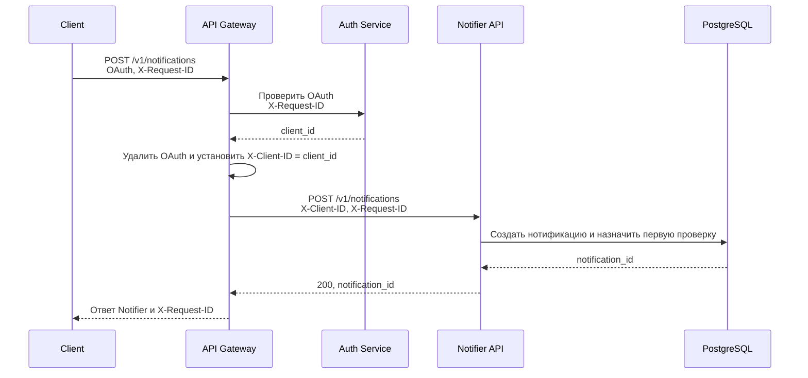
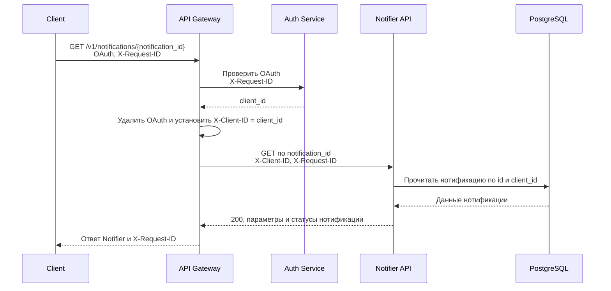
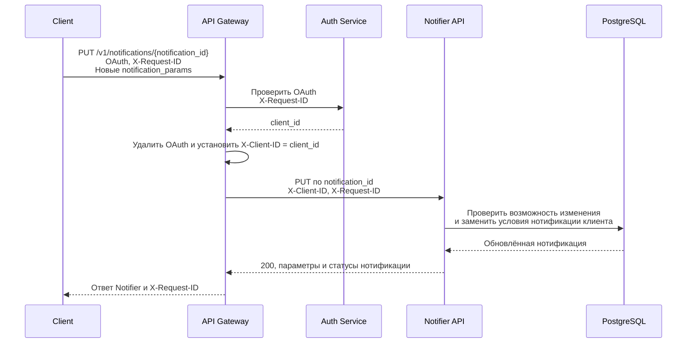
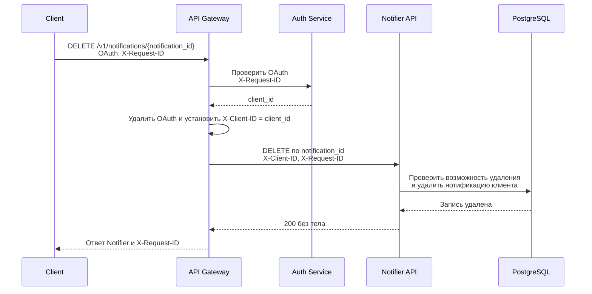
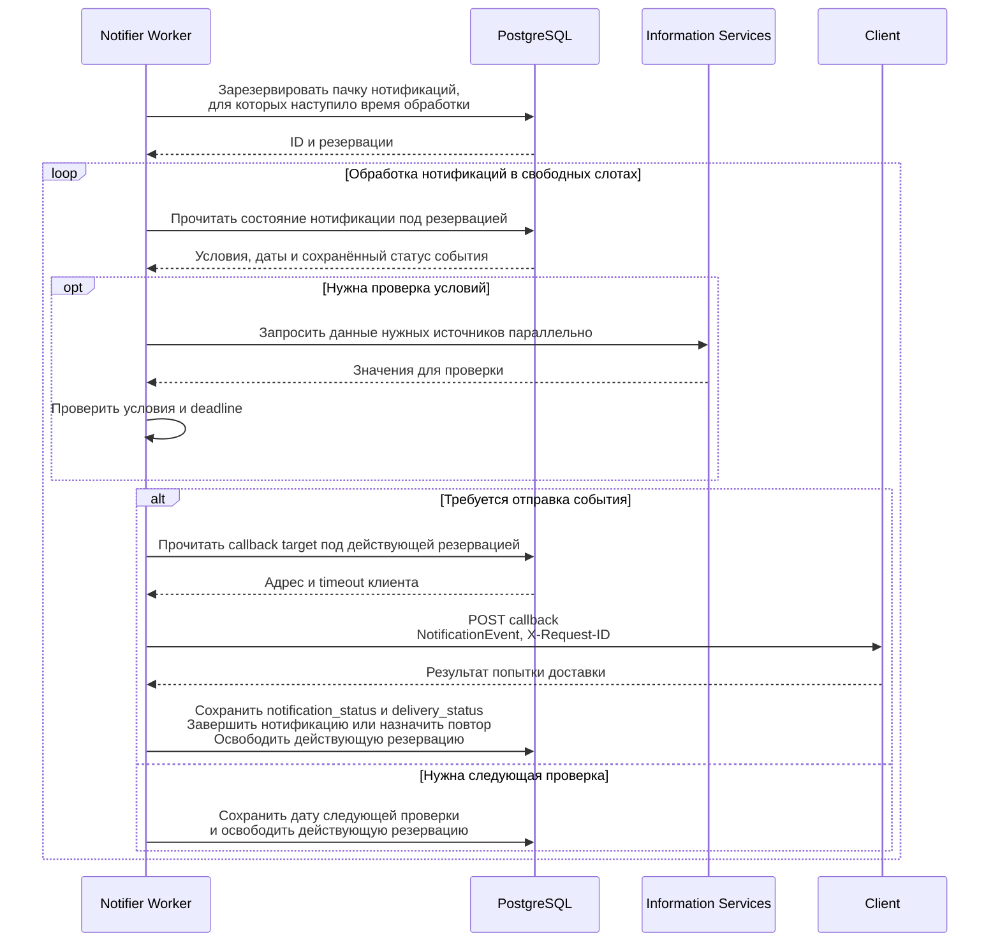
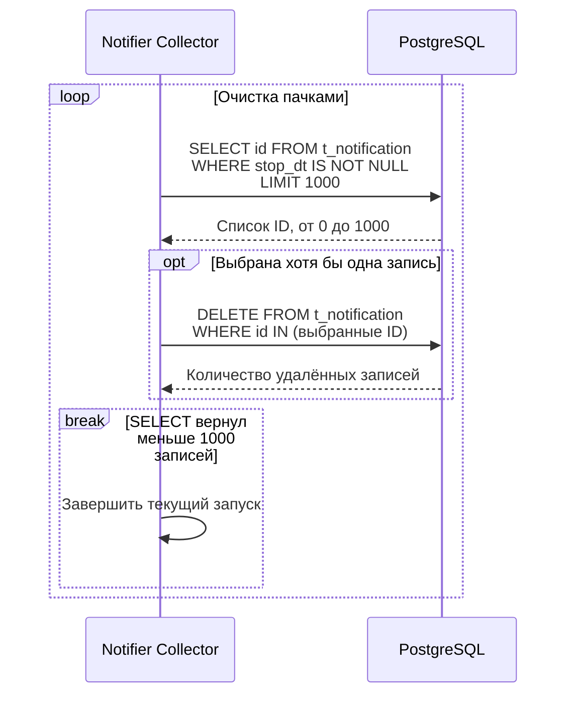

# Notifier

Notifier отправляет клиенту HTTP-уведомление, когда выполняются заданные клиентом условия (`notification_params`): элементы верхнего уровня объединяются по «И», для других комбинаций есть группы `and` и `or` с вложенностью до трёх уровней. API сохраняет параметры, а Worker проверяет условия и доставляет результат асинхронно.

## Целевая архитектура


На схеме показаны два источника данных — Information Service 1 и Information Service 2. Worker может опрашивать и дополнительные источники.

### Компоненты

| Компонент | За что отвечает |
| --- | --- |
| Balancer | Принимает входящий трафик. |
| Anti DDOS | Защита от DDOS атаки. |
| RPS Limiter | Ограничивает частоту запросов. |
| API Gateway | Принимает входящий трафик. Занимается оркестрацией запросов, а также подготовкой запросов извне к работе с внутренними сервисами. Отправляет OAuth на проверку в Auth Service и передаёт в Notifier `X-Client-ID` и `X-Request-ID`. |
| Auth Service | Проверяет авторизацию и аутентификацию клиента. В случае успеха обменивает credentials на `client_id` — внутренний идентификатор клиента. |
| Notifier API | Создаёт, читает, изменяет и удаляет нотификации по запросу пользователя. |
| PostgreSQL | Хранит данные о нотификациях. |
| Notifier Worker | С заданной периодичностью проверяет условия отправки нотификаций, а также занимается их отправкой. |
| Notifier Collector | Пакетно удаляет остановленные нотификации. |
| Directory | Распространяет справочные данные по сервисам платформы. В целевой схеме потребители получают их в память. |
| SQUID | Прокси для ограничения походов в дикий интернет. |

**Доставка рассчитана на at-least-once.** Клиент может получить повторный вызов с тем же `notification_id`, например если обработал уведомление, а Worker не получил ответ. При исчерпании повторов задача завершается с ошибкой доставки.

## Спецификации API

Исходные контракты: [Notifier — `openapi.yaml`](notifier/api/spec/openapi.yaml) и [эмулятор — `openapi.yaml`](emulator/api/spec/openapi.yaml). Типы условий, операторы, форматы, ограничения и JSON-примеры находятся в этих спецификациях; callback описан в [операции создания](notifier/api/spec/paths/notifications.yaml) и [схеме события](notifier/api/spec/components/schemas/events/NotificationEvent.yaml).

HTML для просмотра в браузере можно получить из корня репозитория. Нужны Node.js и npm; команды проверены с Node.js `26.0.0` и Redocly CLI `2.78.0`. При первом запуске npm загружает указанную версию CLI:

```bash
mkdir -p bin/api-docs
npx --yes @redocly/cli@2.78.0 build-docs notifier/api/spec/openapi.yaml --config build/openapi/redocly.yaml --inlineBundle --output bin/api-docs/notifier.html
npx --yes @redocly/cli@2.78.0 build-docs emulator/api/spec/openapi.yaml --config build/openapi/redocly.yaml --inlineBundle --output bin/api-docs/emulator.html
```

Открой `bin/api-docs/notifier.html` или `bin/api-docs/emulator.html` в браузере. `--inlineBundle` включает скрипты визуализации в HTML; файлы в `bin/` не коммитятся. Генерация HTML не меняет контракты или Go-код.

## Диаграммы последовательности

### API

Показаны основные сценарии запросов через Gateway и Auth Service.

<details>
<summary>Create</summary>



</details>

<details>
<summary>Read</summary>



</details>

<details>
<summary>Update</summary>



</details>

<details>
<summary>Delete</summary>



</details>

### Фоновые процессы

<details>
<summary>Worker</summary>



</details>

<details>
<summary>Collector</summary>



</details>

## Ограничения прототипа

| Область | Допущение прототипа |
| --- | --- |
| Входящие запросы | Вызов идёт напрямую в Notifier API с заголовком `X-Client-ID`. OAuth сервиса и API Gateway нет |
| Справочные данные | Directory за рамками прототипа, поэтому используется таблица `t_client` внутри сервиса. В ней у каждого клиента задан максимальный срок жизни нотификации (обязателен; `deadline_dt` не может быть позже `start_dt` плюс этот срок, чтобы нотификации не жили вечно), а также можно переопределить таймаут ответа клиента при доставке (по умолчанию 1 с). |
| Хранение секретов | Отсутсвует интеграция с Valt так как проект локальный. Перед запуском в prod - необходимо настроить сборку так, чтоб пароли к БД брались из Valt |
| Проверка условия | Вместо Information Services используется эмулятор. |
| Эксплуатация | За рамками прототипа остались трассировка, мониторинг, Sentry, Vault, динамическая конфигурация и эксперименты. |
| Сборка и поставка | Предусмотрена локальная сборка Docker-образа. CI/CD за рамками прототипа. |

**TODO — руководство обновления и восстановления:** вернуться после появления телеметрии очереди, callback, lease и ошибок сохранения; на её основе описать признаки сбоя, проверки результата обновления и восстановление незавершённой обработки.

## Локальный запуск и тестирование

Python-тесты рассчитаны на macOS/Linux.

Зависимости:

- Docker с Compose v2+
- `make`
- Bash
- Git
- `curl`
- Go 1.27
- Python [3.14.4](.python-version) с `venv` и pip
- Node.js
- Redocly CLI в `PATH`
- `golangci-lint` v2

### Команды

Все команды выполняются из корня репозитория.

| Команда | Что делает |
| --- | --- |
| `make up` | Собирает образы, запускает PostgreSQL, применяет миграции, запускает API, worker и эмулятор; ждёт их готовности и выводит назначенные адреса. |
| `make down` | Останавливает и удаляет контейнеры выбранного стенда, сохраняя данные PostgreSQL. |
| `make reset` | Останавливает стенд и **удаляет его данные PostgreSQL** вместе с volume. |
| `make migrate` | Применяет миграции и обновляет дампы схемы в `notifier/db/schema/`. |
| `make psql` | Открывает консоль PostgreSQL локального стенда. |
| `make gen` | Проверяет и собирает обе OpenAPI-спецификации, генерирует серверы и клиент Information Service, затем собирает Go-модуль. |
| `make check` | Запускает Go-тесты, vet, lint, проверку форматирования и `git diff --check` без исправления файлов. |
| `make test-integration` | Запускает интеграционные тесты адаптера PostgreSQL в отдельных Docker-контейнерах. |
| `make setup-e2e` | Создаёт Python-окружение и устанавливает закреплённые зависимости e2e. |
| `make test-e2e` | Проверяет версии зависимостей и запускает pytest на работающем Compose-стенде; пакеты не устанавливает. |
| `make lock-e2e` | Обновляет закреплённые версии зависимостей в `tests/e2e/constraints.txt`. |
| `make ai-setup` | Устанавливает локальные ссылки на AI-правила и skills, генерирует определения Codex guards. Нужен Python 3. |
| `make ai-check` | Проверяет AI-файлы и актуальность локального setup без исправлений. Нужны выполненный `make ai-setup` и Python 3.11+. |
| `docker compose ps -a` | Показывает состояние контейнеров выбранного стенда. |
| `docker compose port api 8080` | Показывает текущий адрес API на хосте. Для эмулятора: `docker compose port emulator 8081`; для PostgreSQL: `docker compose port postgres 5432`. |

```bash
export COMPOSE_PROJECT_NAME=notifier_dev
make up
```

Подробности запуска и проверок — в [руководстве разработки](docs/development.md); параметры — в [справочнике конфигурации](docs/configuration.md).

### Три уровня тестирования

| Уровень | Что проверяет | Как запустить |
| --- | --- | --- |
| 1. Модульные Go-тесты | Доменную логику, обработчики HTTP, middleware и работу компонентов с тестовыми зависимостями. Команда также запускает статические проверки; Compose не нужен. | `make check` |
| 2. Интеграционные тесты PostgreSQL | Реальные SQL-запросы, миграции, ограничения и конкурентные изменения. Нужен Docker; тесты сами создают и удаляют отдельные контейнеры PostgreSQL. | `make test-integration` |
| 3. Сквозные API-тесты | HTTP-сценарии на работающем Compose-стенде и состояние PostgreSQL; тот же pytest-прогон включает изолированные тесты Python helpers. | После подготовки ниже: `make test-e2e` |

Подготовка e2e-окружения:

```bash
make setup-e2e
make up
make test-e2e
```

Тесты сами получают адреса через `docker compose port`. Запускай их с тем же `COMPOSE_PROJECT_NAME`, с которым поднят стенд. Правила и переменные настройки — в [инструкции тестирования](ai/rules/tests.mdc#api-end-to-end-tests). Один успешный уровень не означает, что остальные тоже выполнены.

Отдельная проверка миграций относится ко второму уровню: она использует PostgreSQL выбранного Compose-стенда, создаёт временную базу и удаляет её после теста:

```bash
NOTIFIER_MIGRATION_TEST_ADDR="$(docker compose port postgres 5432)" go test -tags=integration -count=1 ./notifier/db/migrations
```

Дополнительные проверки:

| Команда | Что проверяет |
| --- | --- |
| `go test -race ./...` | Гонки данных; запускать при изменениях конкурентной обработки или жизненного цикла. |
| `go vet ./...` | Типичные ошибки Go-кода статическим анализом. |
| `golangci-lint run` | Соблюдение правил линтеров проекта. |
| `golangci-lint fmt --diff` | Показывает необходимые изменения форматирования без записи файлов; проверь, что diff пуст. |
| `git diff --check` | Ошибки пробелов и маркеры конфликтов в diff. |

### Логи сервисов Docker

```bash
docker compose logs --tail=100 -f api
```

Команда показывает последние 100 строк API и продолжает выводить новые. `Ctrl+C` завершает просмотр, сервис продолжает работать. Вместо `api` укажи `notification_worker`, `emulator`, `postgres` или `migrate`. Несколько имён через пробел покажут их логи вместе; без имени выводятся все сервисы.

```bash
docker compose logs --since=10m notification_worker
```

Этот вариант выводит логи worker за последние 10 минут без ожидания новых строк.

## Структура репозитория

```
├── notifier/
│   ├── api/                           # OpenAPI Notifier: исходники в spec/, бандл в bundle/
│   ├── cmd/notifier/                  # Точка входа: режимы api и migrate
│   ├── configs/config.yaml            # Конфигурация Notifier
│   ├── db/
│   │   ├── init/                      # Бутстрап PostgreSQL
│   │   ├── migrations/                # Миграции goose
│   │   └── schema/                    # Дампы схемы, генерируются через make migrate
│   └── internal/
│       ├── application/               # Зависимости и жизненный цикл режимов
│       ├── config/                    # Загрузка конфигурации
│       ├── core/                      # Доменная логика
│       ├── server/                    # Ogen-код, HTTP-обработчики и middleware
│       ├── storage/postgres/          # Репозиторий и SQL
│       ├── interactions/              # Исходящие вызовы
│       ├── worker/                    # Опрос PostgreSQL, резервирование нотификаций и обработка пачек нотификаций
│       └── collector/                 # Очистка остановленных нотификаций
├── emulator/
│   ├── api/                           # OpenAPI эмулятора: исходники в spec/, бандл в bundle/
│   ├── cmd/emulator/                  # Точка входа эмулятора
│   └── internal/
│       ├── application/               # Зависимости и жизненный цикл эмулятора
│       ├── server/                    # Ogen-код и HTTP-обработчики
│       └── storage/memory/            # Пресеты в памяти
├── internal/                          # Общие пакеты обоих сервисов
│   ├── health/                        # Внутренние пробы и управление слушателями
│   ├── logging/                       # Контекст логирования и маскирование
│   └── problem/                       # Ответы Problem Details
├── ai/                                # Правила, скиллы и гварды для Claude Code и Codex
├── tests/e2e/                         # Сквозные API-тесты на pytest
├── build/                             # Dockerfile и общие настройки Redocly и ogen
├── scripts/                           # Скрипты генерации, схемы БД и настройки ИИ
├── docs/                              # Схемы и ADR
├── docker-compose.yaml                # PostgreSQL, миграции, API и эмулятор
├── Makefile                           # Команды разработки
├── .golangci.yaml                     # Конфигурация golangci-lint
├── go.mod                             # Общий Go-модуль
├── AGENTS.md                          # Контекст для ИИ-агентов
├── CLAUDE.md                          # Подключает AGENTS.md для Claude Code
└── README.md                          # Этот файл
```

## Потенциал для масштабирования архитектуры

### Шардирование PostgreSQL по client_id
Можно сделать практически бесконечное горизонтальное масштабирование, отселяя отдельных больших клиентов или десятки маленьких по отдельным базам. Хранить связку shard - client_id можно или в directory или сделать еще одну базу оркестратора

### Холодное хранилище старых нотификаций
В Collector в место удаления нотификаций можно перекладывать их в долгосрочное хранилище. Откуда при желании нотификацию можно восстановить в горячее или сразу дать по ней статус. В качестве такого хранилища можно использовать, например: YTsaurus

## Идеи для дальнейшего развития
1. Батчевые ручки работы с нотификациями
2. Эксперимент перехода с pull схемы работы с нотификациями в worker на push модель используя pg_cron + notify
3. Сделать механизм нагрузочного тестирования в Docker и ai скилл для запуска и  сверки утилизации ресурсов и времени ответа ручек