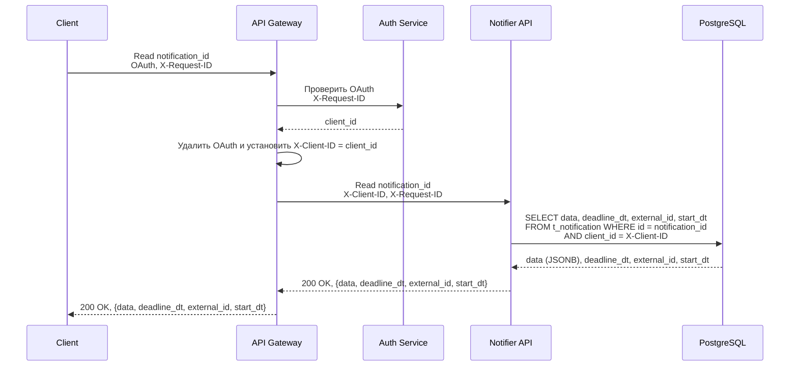
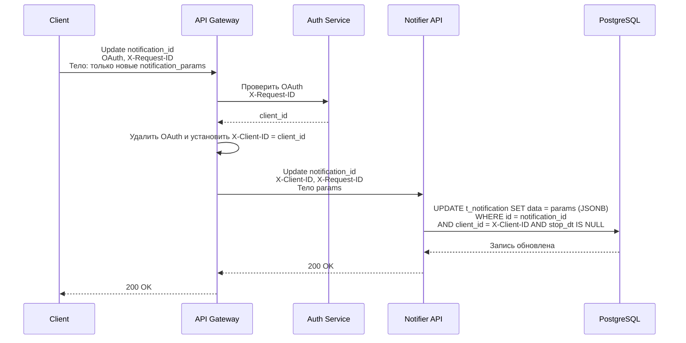
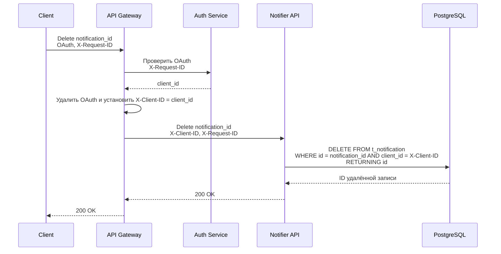
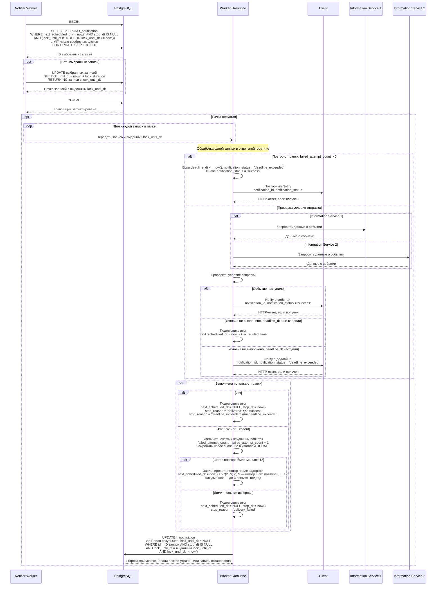
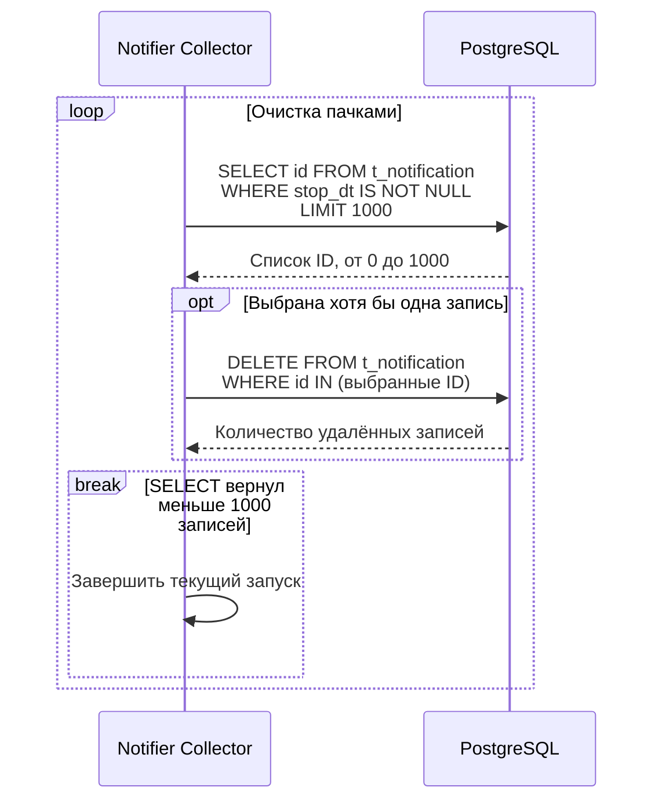

# Notifier

Notifier отправляет клиенту HTTP-уведомление, когда выполняются заданные клиентом условия (`notification_params`): элементы верхнего уровня объединяются по «И», для других комбинаций есть группы `and` и `or` с вложенностью до трёх уровней. API сохраняет параметры, а Worker проверяет условия и доставляет результат асинхронно.

## Целевая архитектура


На схеме показаны два источника данных — Information Service 1 и Information Service 2. Worker может опрашивать и дополнительные источники.

### За рамками архитектурной схемы

- Антиробот для защиты от DDoS.
- Обязательный прокси Squid для выхода во внешний интернет.

## Компоненты

| Компонент | За что отвечает |
| --- | --- |
| Balancer | Принимает входящий трафик. |
| RPS Limiter | Ограничивает частоту запросов. |
| API Gateway | Принимает входящий трафик. Занимается оркестрацией запросов, а также подготовкой запросов извне к работе с внутренними сервисами. Отправляет OAuth на проверку в Auth Service и передаёт в Notifier `X-Client-ID` и `X-Request-ID`. |
| Auth Service | Проверяет авторизацию и аутентификацию клиента. В случае успеха обменивает credentials на `client_id` — внутренний идентификатор клиента. |
| Notifier API | Создаёт, читает, изменяет и удаляет нотификации по запросу пользователя. |
| PostgreSQL | Хранит данные о нотификациях. |
| Notifier Worker | С заданной периодичностью проверяет условия отправки нотификаций, а также занимается их отправкой. |
| Notifier Collector | Пакетно удаляет остановленные нотификации. |
| Directory | Распространяет справочные данные по сервисам платформы. В целевой схеме потребители получают их в память. |

**Доставка рассчитана на at-least-once.** Клиент может получить повторный вызов с тем же `notification_id`, например если обработал уведомление, а Worker не получил ответ. При исчерпании повторов задача завершается с ошибкой доставки.

## Диаграммы последовательности

### API

<details>
<summary>Create</summary>


</details>

<details>
<summary>Read</summary>



</details>

<details>
<summary>Update</summary>



</details>

<details>
<summary>Delete</summary>



</details>

### Фоновые процессы

<details>
<summary>Worker</summary>



</details>

<details>
<summary>Collector</summary>



</details>

Пока остановленная нотификация хранится в базе, владелец может прочитать её через `GET`. Попытка обновить её через `PUT` возвращает `400` с заголовком ошибки `Incorrect notification status`. Для клиента `external_id` занят, пока запись хранится в базе. В этот период повторный `POST` с тем же `external_id` возвращает `409` с ID существующей нотификации. После удаления записи через API или Collector тот же `external_id` можно сразу использовать снова.

## Ограничения прототипа

| Область | Допущение прототипа |
| --- | --- |
| Входящие запросы | Вызов идёт напрямую в Notifier API с заголовком `X-Client-ID`. OAuth сервиса и API Gateway нет |
| Справочные данные | Directory за рамками прототипа, поэтому используется таблица `t_client` внутри сервиса. В ней у каждого клиента задан максимальный срок жизни нотификации (обязателен; `deadline_dt` не может быть позже `start_dt` плюс этот срок, чтобы нотификации не жили вечно), а также можно переопределить таймаут ответа клиента при доставке (по умолчанию 1 с). |
| Проверка условия | Вместо Information Services используется эмулятор. |
| Эксплуатация | За рамками прототипа остались трассировка, мониторинг, Sentry, Vault, динамическая конфигурация и эксперименты. |
| Сборка и поставка | Предусмотрена локальная сборка Docker-образа. CI/CD за рамками прототипа. |

## Локальный запуск

Нужны Docker Compose и `make`. `make up` запускает PostgreSQL, применяет миграции и ждёт готовности Notifier API и эмулятора. С хоста API доступен на `http://127.0.0.1:8080`, эмулятор — на `http://127.0.0.1:8081`. Внутри сети Compose адрес эмулятора — `http://emulator:8081`.

```bash
make up
make down      # остановить стенд, сохранив данные
```

Для работы с локальной базой используй `make psql`. `make migrate` применяет миграции и обновляет дамп схемы, а `make reset` удаляет локальную базу.

## Первая проверка уведомления

`notification.initial_check_delay_sec` в [конфигурации](notifier/configs/config.yaml) задаёт задержку первой проверки в целых секундах: от `0` до `9223372036` включительно (предел `time.Duration` при переводе секунд в наносекунды). Например, `7200` откладывает проверку на два часа. Отрицательное значение или переполнение останавливает запуск с ошибкой конфигурации. Штатное значение указано в файле; при отсутствии параметра или значении `null` загрузчик использует такое же значение по умолчанию.

При создании API сохраняет `next_scheduled_dt = now + initial_check_delay`. Эта задержка не зависит от `notification.scheduled_time_sec` (интервала повторных проверок worker) и callback backoff. Первая дата не ограничивается deadline: если deadline раньше, worker при первой обработке уже просроченной активной записи выберет `deadline_exceeded`.

Новое значение применяется после перезапуска API с обновлённой конфигурацией, только к создаваемым после этого записям. В штатном Compose конфигурация входит в образ: для её обновления нужен `make up` с пересборкой. Hot reload нет. Сохранённые даты не переносятся; API продолжает выполнять INSERT, а worker — обрабатывать старую очередь. Задержка уменьшает новую нагрузку от проверок, но не приостанавливает работу с БД.

## Тестирование

Для тестов нужен Go 1.27. `go test ./...` запускает тесты доменной логики, HTTP-обработчиков и middleware. Для расчёта покрытия используй [команду из PR-скилла](ai/skills/pr-description/SKILL.md#test-coverage).

Для интеграционных тестов PostgreSQL запусти Docker и выполни `go test -tags=integration -count=1 ./notifier/internal/storage/postgres`.

Сквозные API-тесты на pytest запускаются на текущем Docker Compose. См. [правила запуска](ai/rules/tests.mdc). Если API запущен с другой задержкой первой проверки, передай её тестам через `NOTIFIER_E2E_INITIAL_CHECK_DELAY_SEC` в секундах; эта переменная задаёт ожидание теста, конфигурацию API она не меняет.

## Структура репозитория

```
├── notifier/
│   ├── api/                           # OpenAPI Notifier: исходники в spec/, бандл в bundle/
│   ├── cmd/notifier/                  # Точка входа: режимы api и migrate
│   ├── configs/config.yaml            # Конфигурация Notifier
│   ├── db/
│   │   ├── init/                      # Бутстрап PostgreSQL
│   │   ├── migrations/                # Миграции goose
│   │   └── schema/                    # Дампы схемы, генерируются через make migrate
│   └── internal/
│       ├── application/               # Зависимости и жизненный цикл режимов
│       ├── config/                    # Загрузка конфигурации
│       ├── core/                      # Доменная логика
│       ├── server/                    # Ogen-код, HTTP-обработчики и middleware
│       ├── storage/postgres/          # Репозиторий и SQL
│       ├── interactions/              # Исходящие вызовы
│       ├── worker/                    # Опрос PostgreSQL, резервирование нотификаций и обработка пачек нотификаций
│       └── collector/                 # Очистка остановленных нотификаций
├── emulator/
│   ├── api/                           # OpenAPI эмулятора: исходники в spec/, бандл в bundle/
│   ├── cmd/emulator/                  # Точка входа эмулятора
│   └── internal/
│       ├── application/               # Зависимости и жизненный цикл эмулятора
│       ├── server/                    # Ogen-код и HTTP-обработчики
│       └── storage/memory/            # Пресеты в памяти
├── internal/                          # Общие пакеты обоих сервисов
│   ├── health/                        # Внутренние пробы и управление слушателями
│   ├── logging/                       # Контекст логирования и маскирование
│   └── problem/                       # Ответы Problem Details
├── ai/                                # Правила, скиллы и гварды для Claude Code и Codex
├── tests/e2e/                         # Сквозные API-тесты на pytest
├── build/                             # Dockerfile и общие настройки Redocly и ogen
├── scripts/                           # Скрипты генерации, схемы БД и настройки ИИ
├── docs/                              # Схемы и ADR
├── docker-compose.yaml                # PostgreSQL, миграции, API и эмулятор
├── Makefile                           # Команды разработки
├── .golangci.yaml                     # Конфигурация golangci-lint
├── go.mod                             # Общий Go-модуль
├── AGENTS.md                          # Контекст для ИИ-агентов
├── CLAUDE.md                          # Подключает AGENTS.md для Claude Code
└── README.md                          # Этот файл
```
