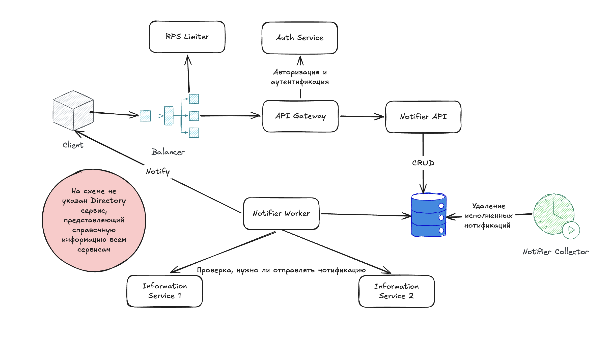
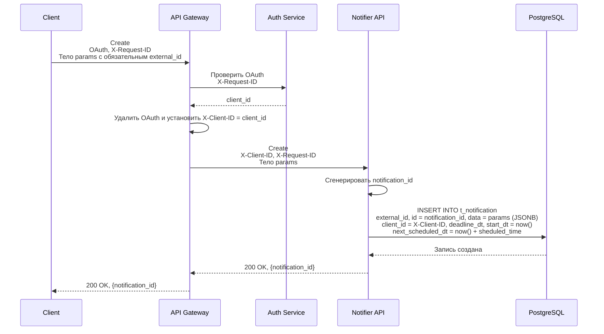
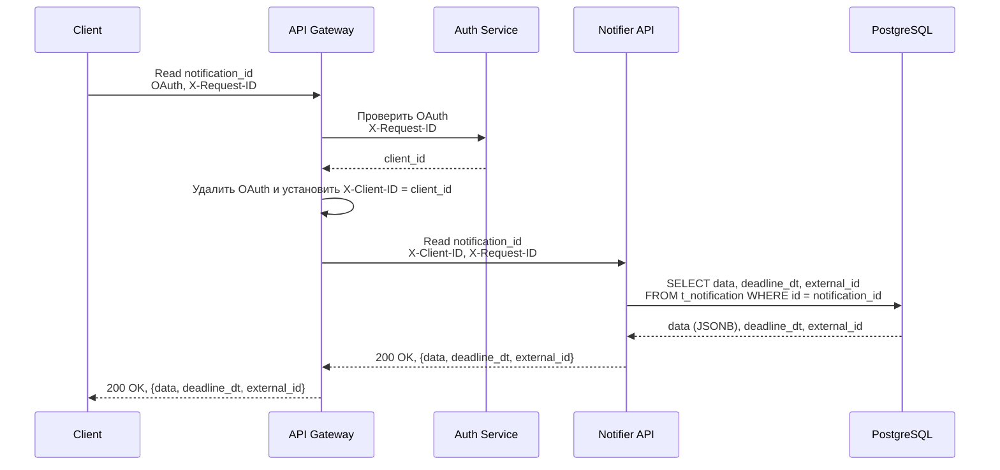
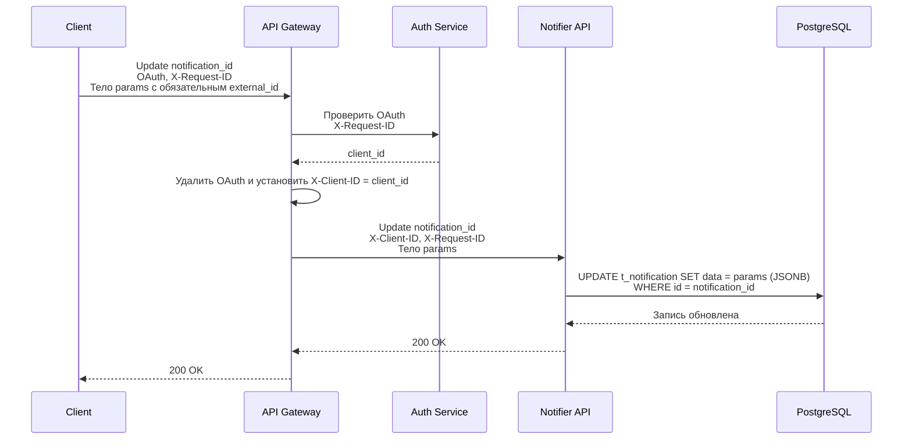
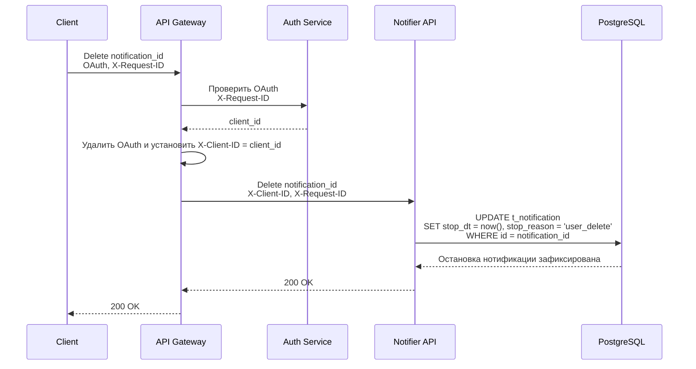
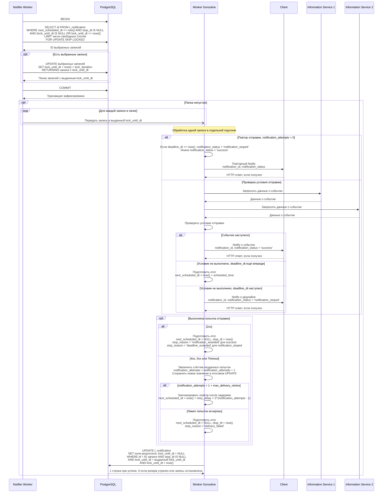
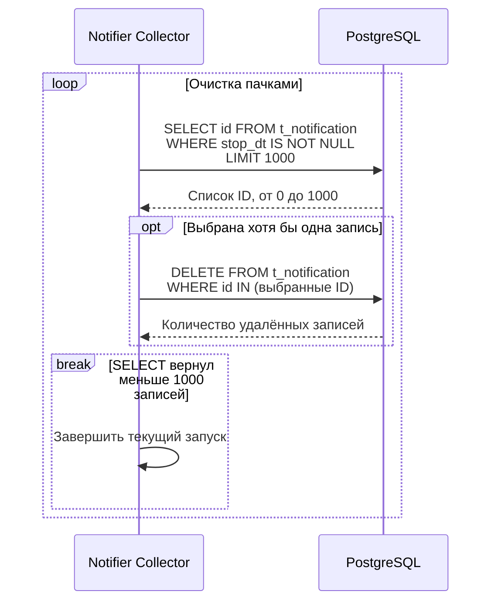

# Notifier

Notifier отправляет клиенту HTTP-уведомление, когда выполняется заданное клиентом условие. API сохраняет параметры, а Worker проверяет условие и доставляет результат асинхронно. В прототипе условие одно — наступление времени `time_of_onset`.

## Целевая архитектура

На схеме показаны два источника данных — Information Service 1 и Information Service 2. Worker может опрашивать и дополнительные источники.

### За рамками архитектурной схемы

- Антиробот для защиты от DDoS.
- Обязательный прокси Squid для выхода во внешний интернет.

## Компоненты

| Компонент | За что отвечает |
| --- | --- |
| Balancer | Принимает входящий трафик. |
| RPS Limiter | Ограничивает частоту запросов. |
| API Gateway | Принимает входящий трафик. Занимается оркестрацией запросов, а также подготовкой запросов извне к работе с внутренними сервисами. Отправляет OAuth на проверку в Auth Service и передаёт в Notifier `X-Client-ID` и `X-Request-ID`. |
| Auth Service | Проверяет авторизацию и аутентификацию клиента. В случае успеха обменивает credentials на `client_id` — внутренний идентификатор клиента. |
| Notifier API | Создаёт, читает, изменяет и удаляет нотификации по запросу пользователя. |
| PostgreSQL | Хранит данные о нотификациях. |
| Notifier Worker | С заданной периодичностью проверяет условия отправки нотификаций, а также занимается их отправкой. |
| Notifier Collector | Пакетно удаляет остановленные нотификации. |
| Directory | Распространяет справочные данные по сервисам платформы. В целевой схеме потребители получают их в память. |

**Доставка рассчитана на at-least-once.** Клиент может получить повторный вызов с тем же `notification_id`, например если обработал уведомление, а Worker не получил ответ. При исчерпании повторов задача завершается с ошибкой доставки.

## Диаграммы последовательности

### API

Create

Read

Update

Delete

### Фоновые процессы

Worker

Collector

## Ограничения прототипа

| Область | Допущение прототипа |
| --- | --- |
| Входящие запросы | Вызов идёт напрямую в Notifier API с заголовком `X-Client-ID`. OAuth сервиса и API Gateway нет |
| Справочные данные | Directory за рамками прототипа, поэтому используется таблица `t_client` внутри сервиса. |
| Проверка условия | Вместо Information Services используется эмулятор. |
| Эксплуатация | За рамками прототипа остались трассировка, мониторинг, Sentry, Vault, динамическая конфигурация и эксперименты. |
| Сборка и поставка | Предусмотрена локальная сборка Docker-образа. CI/CD за рамками прототипа. |
